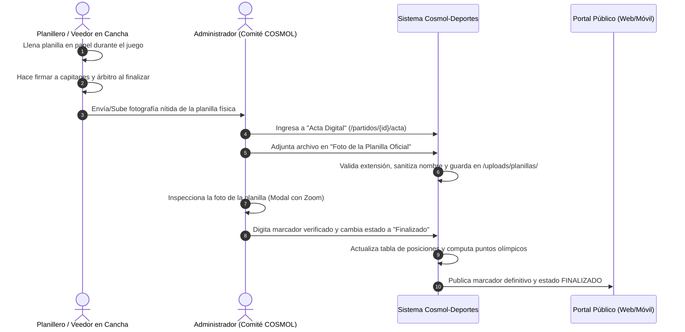

# Plan de Implementación: Respaldo y Verificación Digital de Planilla Oficial de Juego (`foto_planilla`)

> **Documento:** Especificación Técnica y Plan de Ejecución  
> **Ubicación:** `Docs/PLAN_IMPLEMENTACION_FOTO_PLANILLA.md`  
> **Módulo:** Panel Administrativo &bull; Actas Oficiales de Partido (`admin/partidos/acta.php`)  
> **Compatibilidad:** PHP 7.3 nativo &bull; MariaDB 10.4 / MySQL 5.7 &bull; AdminLTE 3 (Bootstrap 4)  
> **Estado:** Documentado / Listo para Ejecución  

---

## 1. Contexto Operativo y Justificación de Negocio

En el marco de las **Olimpiadas Deportivas y Recreativas Inter-Cooperativas COSMOL**, el flujo arbitral y disciplinario oficial opera bajo la siguiente realidad de campo:

1. **La Planilla Física es el Documento Supremo:** En cada cancha o mesa de juego (Fútbol, Futsal, Básquet, Vóley, Billar, Cacho), el planillero o árbitro registra las incidencias, sets y puntaje en un acta impresa en papel, la cual es firmada y refrendada al finalizar el encuentro por los capitanes o delegados de ambas cooperativas y por la terna arbitral.
2. **Cero Transmisión en Tiempo Real Manual:** Durante el desarrollo del partido no existen operadores digitando goles o puntos minuto a minuto. El partido simplemente transcurre en estado `En_Juego` conforme a la hora pactada en el fixture.
3. **Prevención de Controversias e Impugnaciones:** Para proclamar oficialmente el resultado y evitar impugnaciones entre delegaciones de distintos departamentos, el **Comité Organizador (`ADMIN`)** requiere cotejar visualmente el acta física antes de asentar los marcadores definitivos y cerrar el partido como `Finalizado`.
4. **La Solución Propuesta:** Dotar al sistema de una funcionalidad para **adjuntar, previsualizar y ampliar la fotografía de la planilla oficial firmada** directamente en el módulo de acta (`/partidos/{id}/acta`), permitiendo al administrador inspeccionar el documento original mientras digita el marcador final verificado.

---

## 2. Flujo de Trabajo (Workflow de Negocio)



---

## 3. Especificación Técnica por Componente

### 3.1. Base de Datos (MariaDB / MySQL)

Se requiere incorporar la columna `foto_planilla` en la tabla `partidos` para almacenar la ruta relativa del archivo subido.

#### Script de Migración SQL:
```sql
-- Agregar columna foto_planilla en la tabla partidos
ALTER TABLE `partidos` 
ADD COLUMN `foto_planilla` VARCHAR(255) NULL AFTER `observaciones`;
```

> [!NOTE]
> Dado que los métodos `getAll()` y `getById()` del modelo `Partido` utilizan `SELECT p.*`, la nueva columna se integrará de forma automática en todas las consultas y vistas sin requerir reescrituras de SQL en las consultas de lectura.

---

### 3.2. Sistema de Archivos y Seguridad de Carga

1. **Directorio de Destino:**  
   `public/uploads/planillas/`
2. **Seguridad y Nomenclatura del Archivo:**
   - Para evitar sobreescritura accidental, nombres con caracteres especiales o ataques de Directory Traversal:
     ```php
     $extension = strtolower(pathinfo($_FILES['foto_planilla']['name'], PATHINFO_EXTENSION));
     $nuevoNombre = 'planilla_p' . $partidoId . '_' . date('Ymd_His') . '_' . bin2hex(random_bytes(4)) . '.' . $extension;
     ```
3. **Validaciones Estrictas de Seguridad (PHP 7.3):**
   - **Extensiones permitidas:** `jpg`, `jpeg`, `png`, `webp`, `pdf`.
   - **Validación de tipo MIME real:** Emplear `finfo_file(finfo_open(FILEINFO_MIME_TYPE), $tmpName)` para confirmar que sea imagen real o PDF y no un script ejecutable camuflado.
   - **Límite de tamaño:** Máximo 8 MB por fotografía (permite capturas de alta resolución tomadas con celulares modernos).
4. **Protección de Directorio (`public/uploads/planillas/.htaccess`):**
   ```apache
   # Evitar ejecución de código PHP en la carpeta de uploads
   <FilesMatch "\.(php|phtml|php3|php4|php5|php7|phps)$">
       Deny from all
   </FilesMatch>
   Options -Indexes -ExecCGI
   ```

---

### 3.3. Modelo de Datos (`app/models/Partido.php`)

Se incorporan dos métodos dedicados y se actualiza el método `actualizarResultado`:

```php
/**
 * Guarda o actualiza la ruta de la fotografía de la planilla oficial
 *
 * @param int $id
 * @param string|null $rutaFoto
 * @return int
 */
public function actualizarFotoPlanilla($id, $rutaFoto) {
    return $this->update('partidos', [
        'foto_planilla' => $rutaFoto
    ], 'id = :where_id', ['where_id' => (int)$id]);
}

/**
 * Obtiene la ruta de la foto de planilla actual de un partido
 *
 * @param int $id
 * @return string|null
 */
public function getFotoPlanilla($id) {
    $row = $this->fetch("SELECT foto_planilla FROM partidos WHERE id = :id LIMIT 1", ['id' => (int)$id]);
    return $row ? $row['foto_planilla'] : null;
}
```

---

### 3.4. Controlador (`app/controllers/PartidoController.php`)

Se modifica el método `guardarResultado($id)` para que, además del marcador y estado, procese la carga del archivo si se envía:

```php
// En PartidoController::guardarResultado($id):
if (isset($_FILES['foto_planilla']) && $_FILES['foto_planilla']['error'] === UPLOAD_ERR_OK) {
    $file = $_FILES['foto_planilla'];
    $allowedMimes = ['image/jpeg', 'image/png', 'image/webp', 'application/pdf'];
    $allowedExts  = ['jpg', 'jpeg', 'png', 'webp', 'pdf'];

    $ext = strtolower(pathinfo($file['name'], PATHINFO_EXTENSION));
    $finfo = finfo_open(FILEINFO_MIME_TYPE);
    $mime = finfo_file($finfo, $file['tmp_name']);
    finfo_close($finfo);

    if (!in_array($ext, $allowedExts) || !in_array($mime, $allowedMimes)) {
        Session::setFlash('error', 'Formato no permitido. Solo se aceptan imágenes (JPG, PNG, WEBP) o documentos PDF.');
        $this->redirect('/partidos/' . (int)$id . '/acta');
    }

    if ($file['size'] > 8 * 1024 * 1024) { // 8 MB
        Session::setFlash('error', 'La fotografía es demasiado pesada (máximo 8 MB).');
        $this->redirect('/partidos/' . (int)$id . '/acta');
    }

    $uploadDir = PUBLIC_PATH . '/uploads/planillas';
    if (!is_dir($uploadDir)) {
        mkdir($uploadDir, 0755, true);
    }

    // Eliminar foto anterior si existe
    $fotoAnterior = $partido['foto_planilla'];
    if (!empty($fotoAnterior) && file_exists(PUBLIC_PATH . '/' . $fotoAnterior)) {
        @unlink(PUBLIC_PATH . '/' . $fotoAnterior);
    }

    $fileName = 'planilla_p' . $id . '_' . date('Ymd_His') . '_' . bin2hex(random_bytes(4)) . '.' . $ext;
    $destPath = $uploadDir . '/' . $fileName;

    if (move_uploaded_file($file['tmp_name'], $destPath)) {
        $rutaRelativa = 'uploads/planillas/' . $fileName;
        $this->partidoModel->actualizarFotoPlanilla($id, $rutaRelativa);
    }
}
```

---

### 3.5. Vista de Acta (`app/views/admin/partidos/acta.php`)

1. **Añadir `enctype="multipart/form-data"`** al formulario principal de cierre de acta (`<form action="..." method="post" enctype="multipart/form-data">`).
2. **Nuevo Bloque UI:** Añadir una tarjeta en AdminLTE 3 titulada **"Foto de Planilla Oficial (Respaldo en Papel)"**.

#### Diseño de la Tarjeta en la Vista:
- **Caso A (Sin foto adjunta):**
  - Muestra un contenedor con icono de documento vacío.
  - Input `type="file"` con diseño de Bootstrap 4 (`custom-file`).
  - Mensaje de ayuda: *"Suba una foto nítida de la planilla física firmada por los capitanes y árbitro."*
- **Caso B (Con foto adjunta):**
  - Muestra la miniatura de la imagen (o icono de PDF).
  - Botón interactivo: **"🔍 Ver Planilla Completa"** (abre un modal Bootstrap 4 a pantalla completa con zoom).
  - Botón: **"⬇️ Descargar"**.
  - Opción para **"Reemplazar foto"** por si se subió una imagen borrosa.

#### Modal de Inspección a Pantalla Completa:
Permite al administrador abrir la imagen en tamaño real, hacer scroll/zoom sobre las casillas de puntos y firmas, y transcribir los números a los campos de texto con exactitud.

---

## 4. Matriz de Tareas y Checklist de Implementación

| # | Tarea | Componente | Estimación | Dependencias |
|---|---|---|:---:|---|
| **1** | Ejecutar script SQL `ALTER TABLE partidos ADD COLUMN foto_planilla` | DB / MySQL | 5 min | Acceso a DB |
| **2** | Crear carpeta `public/uploads/planillas` y su archivo `.htaccess` anti-ejecución | Filesystem | 5 min | Permisos de escritura |
| **3** | Agregar métodos `actualizarFotoPlanilla` y `getFotoPlanilla` en el modelo | `app/models/Partido.php` | 10 min | Tarea 1 |
| **4** | Integrar procesamiento de carga segura y reemplazo en el controlador | `app/controllers/PartidoController.php` | 20 min | Tarea 2 y 3 |
| **5** | Diseñar el componente UI de subida y el Modal de Zoom en el acta | `app/views/admin/partidos/acta.php` | 30 min | Tarea 4 |
| **6** | Pruebas integrales de subida, validación de formatos, zoom y guardado final | QA / Pruebas | 20 min | Tarea 5 |

---

## 5. Casos de Prueba y Criterios de Aceptación

1. **Carga exitosa de foto JPG/PNG:**  
   *Criterio:* La imagen se guarda en `public/uploads/planillas/`, la ruta se almacena en la base de datos y la miniatura aparece de inmediato en el acta.
2. **Rechazo de archivo no permitido:**  
   *Criterio:* Si un usuario intenta subir un archivo `.exe`, `.php` o `.zip`, el sistema rechaza la solicitud con una alerta de error visible y sin modificar la base de datos.
3. **Reemplazo limpio de archivo:**  
   *Criterio:* Al subir una nueva foto para un partido que ya tenía una planilla anterior, el archivo antiguo se elimina del disco para evitar saturación de almacenamiento.
4. **Inspección en Modal:**  
   *Criterio:* Al hacer clic en "Ver Planilla Completa", se despliega un modal responsive con la imagen en alta definición permitiendo leer firmas y números de sets/goles.
5. **Cierre de Acta y Publicación:**  
   *Criterio:* Al marcar `Finalizado` habiendo verificado la foto, el marcador oficial queda registrado, se actualizan las tablas de posiciones y en el portal público se muestra el resultado final.
